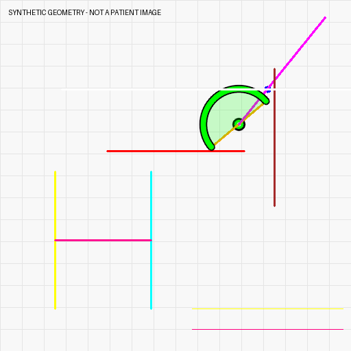

# KAP-DDH: Preoperative Acetabular Reconstruction Planning

**Version 1.0.0**

This repository provides the source code and graphical user interface for the preoperative planning module of KAP-DDH, for acetabular reconstruction in developmental dysplasia of the hip (DDH).

The module combines geometric candidate generation, constraint-based scoring and interactive visualization. **The released example runs in fixed-constraint mode.** It provides a complete, runnable example of this planning workflow using synthetic geometry and computed reference outputs.

## Features

- **Planning engine:** generate and rank candidate cup positions from prepared images, masks, landmarks and calibrated pixel spacing.
- **Graphical interface:** inspect planning geometry and candidate plans in an English PyQt5 desktop application.
- **Configuration:** set input paths, Crowe group constraints, scoring weights and output locations.
- **Synthetic example:** run the planner, view a computed plan and check the results against a bundled reference.
- **Integration interface:** apply study-specific constraints through the existing planning-side adapter; see [integration](docs/INTEGRATION.md).

## Installation

Tested with Python 3.12 on Linux using the CPU. From the repository folder, create an isolated environment:

```bash
python -m venv .venv
```

Activate on Windows PowerShell:

```powershell
.\.venv\Scripts\Activate.ps1
```

Or on Linux/macOS:

```bash
source .venv/bin/activate
```

Install the dependencies:

```bash
python -m pip install -r requirements.txt
```

The CPU example runs without PyTorch or specialized hardware. Installation took approximately 44 seconds in a new Python 3.12 environment with the normal pip download cache enabled; first-time downloads may take several minutes. Desktop use requires a graphical session and Qt support. The recorded GUI checks used Linux with the Qt offscreen platform; interactive Windows/macOS operation remains outside those checks.

## Run the example

```bash
python run_planning.py --config examples/demo_config.py --case SYNTHETIC_001 --level 1
```

The result is saved to `outputs/cli/SYNTHETIC_001.json`. In the tested environment, the example returns one regular plan and one fallback plan, with an observed runtime of approximately 1–3 seconds after imports. Runtime varies with hardware.

Check the calculation against the bundled reference:

```bash
python scripts/verify_demo.py
```

Open the graphical interface:

```bash
python run_planning.py --config examples/demo_config.py --gui
```

Select `SYNTHETIC_001`, keep Crowe class I, and choose **Planning → Generate Preoperative Plans**. The launcher starts with GPU acceleration unchecked. GUI saved plans and CLI batch results use separate JSON schemas and output directories; use the GUI's own saved-plan files when reopening a plan.



See the [example guide](examples/README.md) for the geometry, expected values and visualization command.

## Plan with prepared inputs

Prepare matching PNG images, binary masks, ordered landmark coordinates and a calibrated scale workbook as described in [input and output formats](docs/INPUTS.md). Copy `config.py` to `config.local.py` and set the paths and scale-table column mapping for your inputs.

```bash
python run_planning.py --config config.local.py --case YOUR_CASE_ID --level 1
```

The supported entry point is `run_planning.py`, for both CLI and GUI use. It checks input consistency and requires an exact, positive scale match before CPU planning. GUI inputs are checked at startup; restart with a matching configuration when changing datasets. Prepared masks and landmarks are the starting point of the planning workflow.

When reading results, distinguish continuous geometric diameter from nominal cup diameter, and angular coverage from the horizontal coverage index. Check the `is_valid` and `is_special_fallback` flags alongside the ranking scores. Field definitions and units are given in the [output reference](docs/INPUTS.md#cli-output).

## Documentation

| Guide | Purpose |
|---|---|
| [Inputs and outputs](docs/INPUTS.md) | File preparation, configuration, units and result fields |
| [Integration](docs/INTEGRATION.md) | How study-specific constraints enter the planning engine |
| [Synthetic example](examples/README.md) | Demonstration geometry and computed reference values |
| [Validation record](docs/VALIDATION.md) | Software checks and the tested environment |
| [Release guide](docs/RELEASING.md) | GitHub and Zenodo release text and metadata |
| [Change log](CHANGELOG.md) | Version history |

The main source files are `planning_core.py`, `planning_ui.py`, `config.py` and `run_planning.py`.

## Scope and availability

This release covers the preoperative planning module. The synthetic example demonstrates execution of that module; it is not a reproduction of the complete KAP-DDH research workflow or the manuscript experiments, and the software checks do not establish clinical validity.

Study-specific resources used in the full research workflow are managed separately in accordance with institutional data-governance requirements. Relevant supporting materials can be made available to editors and reviewers for manuscript evaluation where appropriate.

## License

The public source files in this repository are licensed under **GNU GPL version 3 only (GPL-3.0-only)**. See [LICENSE](LICENSE). Third-party dependencies retain their own licenses.

## Citation and support

Please cite the specific archived software version that you use. The software version is recorded in [VERSION](VERSION) and [CHANGELOG.md](CHANGELOG.md). Use the DOI assigned to the published Zenodo release when it is available. Report reproducible software issues through the repository issue tracker, using synthetic or otherwise shareable examples.
